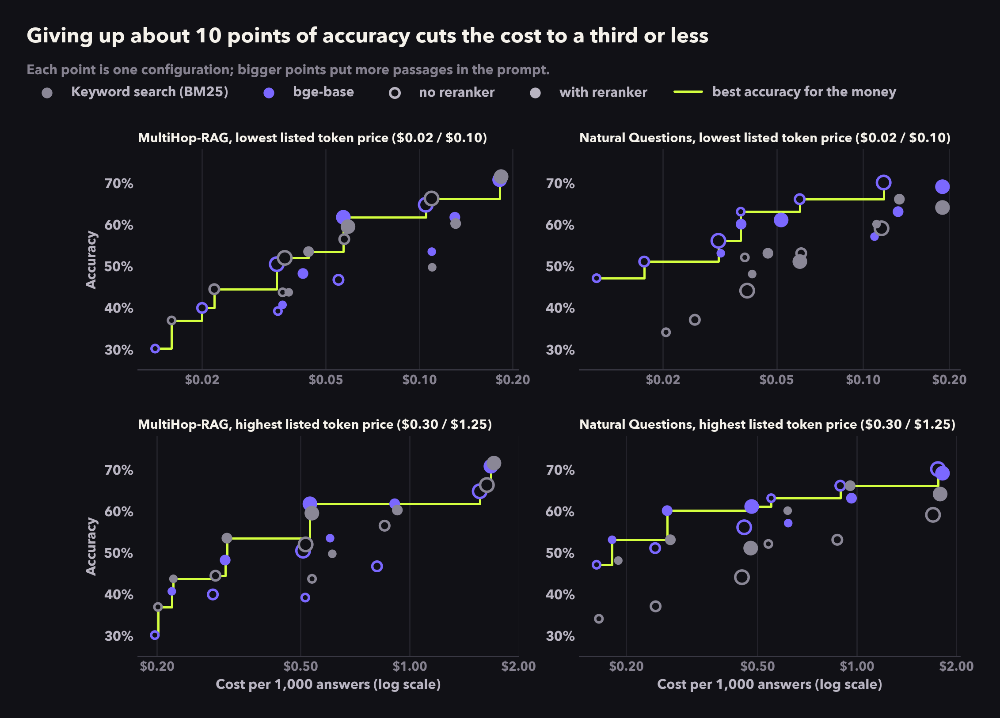

# RAG per dollar

**Which RAG choices actually improve answers per dollar, and do retrieval scores even predict answer quality?** Retrieval scores rank setups almost exactly as answers do, but overstate what a change is worth. The best first upgrade depends on the token price: more passages when tokens are cheap, a reranker when they are expensive. And on multi-hop questions, 9 of 24 setups did worse than a guess that never reads.

[](https://github.com/ai-with-md/rag-per-dollar/actions/workflows/tests.yml)




## What we found

| Common belief | What happened | Notebook |
|---|---|---|
| Any RAG beats no RAG | On MultiHop-RAG, **9 of 24** setups scored below a guess that never reads (48.1%), and the worst (30%) scored below the same model with no documents (38%) | [03](notebooks/03_answers.ipynb) |
| Retrieval scores tell you what an upgrade is worth | They rank setups almost as answers do (rank correlation **0.96** and **0.95**), but on Natural Questions only about **60%** of the retrieval gain from longer chunks or more passages reached accuracy | [04](notebooks/04_retrieval_vs_answers.ipynb) |
| A reranker is the first upgrade to buy | Only when tokens are expensive. At the lowest listed price, going from 3 to 5 passages bought **69.5** and **31.1** points per extra 10 cents per 1,000 answers, against **17.9** and **13.1** for the reranker. At the highest price the reranker led, **15.9** and **12.4** against 4.6 and 2.1 | [05](notebooks/05_cost.ipynb) |
| Embeddings beat keyword search | It depends on the questions: bge-base was **7.9 points** better on Natural Questions, and 2.5 points lower on MultiHop-RAG, too close to call | [03](notebooks/03_answers.ipynb) |
| If retrieval finds the answer, the model gets it right | On questions it could not answer alone, it still missed about **three in ten** with the evidence in the prompt | [04](notebooks/04_retrieval_vs_answers.ipynb) |
| A retrieval miss only hurts what the model did not know | On questions it knew without documents, a miss cut it to **35%** right on MultiHop-RAG and **50%** on Natural Questions, usually because it declined to answer | [04](notebooks/04_retrieval_vs_answers.ipynb) |
| Accuracy levels off quickly as prompts grow | It was still rising at the largest prompts tested, about 5,300 to 5,800 tokens | [05](notebooks/05_cost.ipynb) |
| The top setup is the one to run | Giving up about 10 points of accuracy cuts the cost to **a third or less** | [05](notebooks/05_cost.ipynb) |
| Good settings carry over to new data | Between the two datasets the rank correlation was only **0.61**, and the best setup differed | [05](notebooks/05_cost.ipynb) |

Accuracy is the share of answerable questions answered correctly, with 95% intervals in the notebooks. The 6,250 answers came from Gemma 4 E4B running locally, about 9 hours on an Apple M4, so the study paid no API fees. Dollar figures are what the same token counts would cost on a hosted model.

## What to do with it

| If you want to | Do this | Why |
|---|---|---|
| **Get the highest accuracy** | Use 512-token chunks and 10 passages, and test the retriever and reranker on your own questions | Best on both datasets, and accuracy was still rising at the largest prompts |
| **Spend about a third as much** | Use smaller or fewer passages and accept about 10 points less | 31% of the best's cost on MultiHop-RAG, 15% to 32% on Natural Questions |
| **Upgrade on cheap tokens** | Add passages before a reranker | 31 to 70 points per 10 cents for going from three to five |
| **Upgrade on expensive tokens** | Add a reranker before more passages | 12 to 16 points per 10 cents, because its cost does not grow with the token price |
| **Choose between setups cheaply** | Rank them by retrieval score on your own data, then generate answers for the last few | Retrieval ranks setups well but overstates how much a change is worth |
| **Reuse someone else's settings** | Do not, without testing | The best setup differed between the two datasets |

## The study

A fixed grid of 54 configurations, every combination of the levels below. All 54 are scored on retrieval. Answers are generated for 24 of them (128 and 512 tokens, keyword search and bge-base), on 150 MultiHop-RAG questions and 100 Natural Questions.

| Choice | Levels |
|---|---|
| Chunk size | 128, 256, 512 tokens |
| Retriever | keyword search (BM25), all-MiniLM-L6-v2, bge-base-en-v1.5 |
| Reranker | none, or bge-reranker-base |
| Passages given to the model | 3, 5, 10 |

## Notebooks

| # | Question | Short answer |
|---|---|---|
| [01](notebooks/01_data_and_floors.ipynb) | What are we testing, and how far does guessing get? | Always giving the most common answer gets 47% of answerable MultiHop-RAG questions right |
| [02](notebooks/02_retrieval.ipynb) | Which configurations find the evidence? | The best retriever depends on the questions, and reranking is the slow step |
| [03](notebooks/03_answers.ipynb) | How often are the answers right? | The best setups get 71% and 70%, against 38% and 20% with no documents |
| [04](notebooks/04_retrieval_vs_answers.ipynb) | Do retrieval scores predict the answers? | They rank setups well but overstate the size of a gain |
| [05](notebooks/05_cost.ipynb) | What does each choice cost, and which is worth it? | From about 1 cent to \$1.82 per 1,000 answers; the best upgrade depends on the token price |

## How the study is run

- **The plan came first.** The [analysis plan](plans/analysis_plan.md) was written before any answers were generated. Two later changes are dated and marked in it.
- **Same questions for every setup.** Comparisons are paired by question, with 95% intervals from 2,000 bootstrap resamples.
- **Grading is checked.** A matching rule decides the clear cases and a local Gemma 4 12B judge decides the rest. 150 grades were checked by hand: 99 of 100 on MultiHop-RAG and 45 of 50 on Natural Questions agreed. Weighted across all answers, that is about 99.8% and 94.1%. The judge's prompt was not changed after the check.
- **Costs come from measured use.** Token counts are from the model runs, and search and reranking times were measured, then priced at \$0.145 an hour.
- **The token price is a range.** On November 20, 2026, no provider's own page confirmed a price for Gemma 4 E4B, and third-party listings ran from \$0.02 to \$0.30 per million input tokens and \$0.10 to \$1.25 per million output tokens. Costs are shown at the lowest and highest listing.

## What this cannot tell

- **The dollar figures are estimates.** Prices are third-party listings, machine times come from an Apple M4, and prompt caching, batch discounts and retries are not priced.
- **The sample is small.** Between two single setups, only differences of about 9 points on MultiHop-RAG and 11 on Natural Questions can be detected. The planned rule for approving a cheaper setup within 5 points found a saving of at most 1.9%, so the larger savings above are observed, not confirmed.
- **One model, one prompt, two English datasets with short answers.** Long-form answers, other domains, larger models or tuned prompts may behave differently.

## What I would do next

- Run more questions on the few setups that matter, to confirm the cheaper options.
- Test prompts beyond 6,000 tokens to find where accuracy levels off.
- Repeat with a second answer model and with prompt caching on a hosted endpoint.

## Data

- **[MultiHop-RAG](https://huggingface.co/datasets/yixuantt/MultiHopRAG)** (Tang and Yang, 2024; ODC-BY): 609 news articles from late 2023 and 2,556 questions whose evidence is spread over several articles.
- **[Natural Questions](https://huggingface.co/datasets/google-research-datasets/natural_questions)** (Kwiatkowski et al., 2019; CC BY-SA 3.0): real Google search questions answered from full Wikipedia pages. The first two of the seven validation files are used.

Neither dataset is stored in this repo. `scripts/download_data.py` fetches both from Hugging Face.

## Run it

```bash
git clone https://github.com/ai-with-md/rag-per-dollar
cd rag-per-dollar
python3 -m venv .venv
source .venv/bin/activate
pip install -e ".[run,notebooks,dev]" evalsize
python scripts/download_data.py
jupyter notebook notebooks/
```

Answers, grades and retrieval scores are saved in `results/`, so notebooks 03 to 05 run after the data download, with no models. Run the tests with `pytest`; they need no data or models.

To rerun everything from scratch (needs [Ollama](https://ollama.com) running):

```bash
python scripts/build_retrieval.py   # about 6 hours on an Apple M4
ollama pull gemma4:e4b-it-qat
ollama pull gemma4:12b-it-qat
python scripts/run_answers.py multihop_rag        # 5.3 hours
python scripts/run_answers.py natural_questions   # 3.8 hours
python scripts/grade_answers.py multihop_rag natural_questions   # about 11 minutes
```

## Layout

```
ragdecisions/   small helpers: data loading, chunking, text matching, grading, costs, the fixed grid, chart style
notebooks/      one notebook per question, outputs saved
plans/          the analysis plan, written before any answers
results/        the fixed samples, retrieval scores, timings, generated answers, grades and the hand check
tests/          unit tests, run on every push
docs/figures/   charts used in this README
scripts/        data download, retrieval, answer generation and grading
```

## License

MIT for the code. Each dataset and model keeps its own license.
